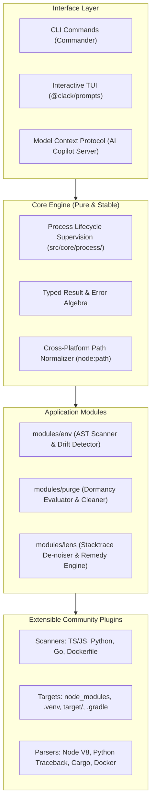

# DEA — Developer's Everyday Assistant

> **A local-only, zero-cloud developer companion that eliminates daily friction: environment drift, runaway disk bloat, and cryptic terminal crashes.**

[](https://github.com/kaushikrawal4365/DEA/actions/workflows/ci.yml)
[](https://opensource.org/licenses/MIT)
[](https://nodejs.org/)

---

## Why DEA?

Developers waste hours every week on three frustrating problems:

1. **Broken `.env` files**: Pulling code from Git only to have it crash because an environment variable was added without updating `.env.example`, or accidentally committing live API keys.
2. **Hidden disk bloat**: Laptops filling up with 60GB+ of forgotten `node_modules`, stale `.venv` folders, Rust `target/` caches, and dangling Docker images from projects untouched for 6 months.
3. **Cryptic terminal crashes**: A failed build or test spits out 200 lines of internal framework stack frames where the actual root-cause error is buried on line 187.

**DEA is built to solve all three locally, safely, and instantly.**

---

## The Three Pillars

```
   ┌────────────────────────────────────────────────────────┐
   │         DEA — Developer's Everyday Assistant           │
   ├───────────────────┬───────────────────┬────────────────┤
   │     dea env       │     dea purge     │    dea lens    │
   │  Secret & Config  │   Safe Dev Disk   │ Terminal Crash │
   │     Sentinel      │      Cleaner      │   Detective    │
   └───────────────────┴───────────────────┴────────────────┘
```

### 1. `dea env` — Environment & Secret Sentinel

- **Drift Detection**: Scans your codebase (TypeScript, JavaScript, Python, Go) for used environment variables and flags missing variables in `.env`.
- **Sync Checking**: Verifies that `.env.example` stays in sync with actual code requirements.
- **Secret Leak Prevention**: Scans files before commit for high-entropy strings, AWS tokens, Stripe keys, and GitHub PATs.

### 2. `dea purge` — Safe Disk & Bloat Reclaimer

- **Dormancy Heuristics**: Analyzes your projects against git commit recency and file access times to identify abandoned build artifacts.
- **Guaranteed Safety**: Always runs with an interactive confirmation checklist and `--dry-run` safety. Never deletes uncommitted code.
- **Cross-Platform File Lock Handling**: Gracefully handles Windows file locks (`EBUSY`) and permission boundaries.
- **Pluggable Targets**: `node_modules`, `.next`, Rust `target/`, Python `.venv`/`__pycache__`, `.gradle`, and Docker build cache.

### 3. `dea lens` — Terminal Crash Demystifier

- **Universal OS Layer**: Instantly diagnoses cross-language system crashes: port collisions (`EADDRINUSE` / `WSAEADDRINUSE`), out-of-memory (`137`), permission issues, and missing binaries.
- **Noise Stripping**: Collapses 100+ internal runtime frames (Node.js internals, Webpack loaders) to spotlight the exact line in _your_ code that broke.
- **Actionable Remedies**: One-click or copyable commands to resolve port conflicts or missing dependencies.
- **Fail-Closed Unknowns**: If an error pattern is unrecognized, DEA preserves raw output without guessing and provides a one-click link to submit a pattern test fixture.

---

## Architecture

DEA follows clean, inward-flowing hexagonal architecture with strict separation between user interfaces, core orchestration, domain semantics, and pluggable analyzers:



---

## Guarantees & Philosophy

- **100% Free & Open Source**: Licensed under MIT. Free for personal, commercial, and educational use forever.
- **100% Local-First**: No data leaves your machine. No telemetry, no third-party cloud servers, no account required.
- **Fail-Closed Safety**: Destructive operations always require explicit confirmation or `--force`. Dry-run is standard.
- **Epistemic Honesty**: We distinguish strictly between **Observations** (direct facts), **Derivations** (algorithmic proofs), **Inferences** (hypotheses), and **Unknowns** (explicit gaps).

---

## Quickstart

### Prerequisites

- Node.js >= 20.0.0
- npm >= 10.0.0 (or pnpm / yarn)

### Installation (Local Development)

```bash
# Clone the repository
git clone https://github.com/kaushikrawal4365/DEA.git
cd DEA

# Install dependencies
npm install

# Run typecheck and linting
npm run check:fast

# Run the test suite
npm test
```

---

## Contributing

We welcome community contributions! DEA is designed around small, isolated plugins so anyone can add a new cleanup target or environment scanner in under 30 minutes.

- Please read our [Repository Guidelines (AGENTS.md)](./AGENTS.md) for architectural invariants.
- Check out the [Contribution Guide (CONTRIBUTING.md)](./CONTRIBUTING.md) to get started.

---

## License

[MIT](./LICENSE) © 2026 Kaushik Rawal and DEA Contributors
